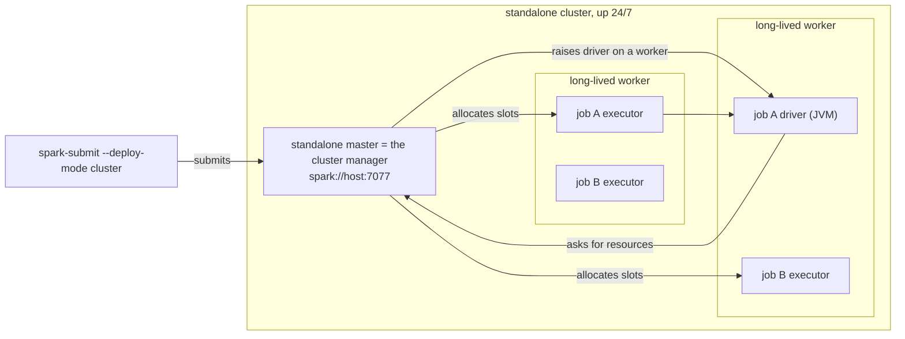
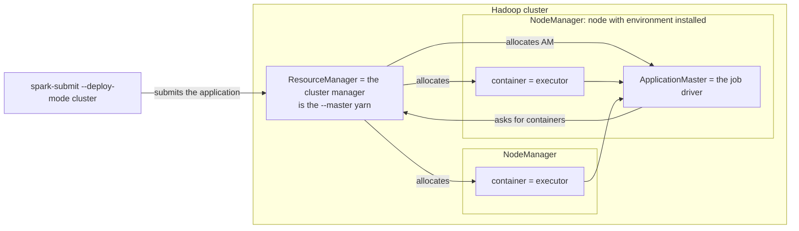
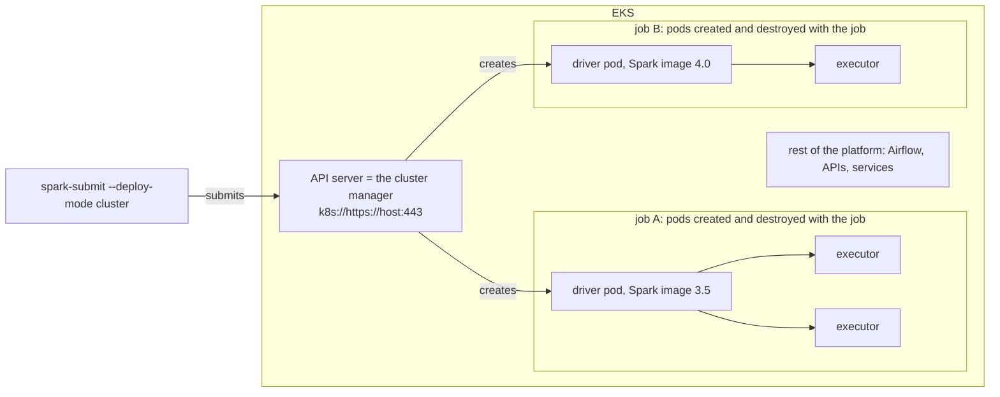

# 2. Cluster Managers

Spark supports Standalone, YARN and Kubernetes.

The three diagrams on this page are in **cluster mode** — driver allocated by the cluster manager itself, along with the executors — so they can be compared. What changes from one to the other is the unit the cluster manager delivers: slot, container or pod. Where the driver can live in each case is the subject of [deploy modes](03-deploy-modes.md).

Each one calls its pieces by a different name, and that is what confuses most in the comparison. Who is who:

| cluster manager | who is the "master", what goes in `--master` | who puts the process up | where the driver is born in cluster mode |
|---|---|---|---|
| Standalone | the Spark master process: `spark://host:7077` | the master itself | one more JVM inside a long-lived worker |
| YARN | the ResourceManager: `yarn`, with the address coming from Hadoop config | the NodeManager of the chosen node | the ApplicationMaster container |
| Kubernetes | the API server: `k8s://https://host:443` | the Kubernetes scheduler, via the API server | a pod of its own |

Notice that only in YARN does the driver get a proper name (ApplicationMaster). In the other two it is the same process as always, just changing the box it fits in.

## Standalone

The scheduler that comes with Spark. It brings up a master and long-lived workers; the master shares slots among applications.

- **Pros:** simple, zero external dependency, hot cluster.
- **Cons:** resource parked, dimensioned for the peak; no real dependency isolation (all applications use the same environment installed on the worker); no real autoscaling.

The allocation unit is a **slot on a worker that is already up** — including for the driver, which in cluster mode is just one more JVM inside a worker. From this same drawing come the two cons: jobs A and B share worker and installed environment, and the outer box keeps existing — and being paid for — when there is no job running at all.

## YARN

The standard of the Hadoop world, and what EMR on EC2 uses.

- **Pros:** mature, strong queues and multi-tenancy, ready integration with HDFS and Hive, resolved external shuffle service.
- **Cons:** requires a whole Hadoop stack just to schedule; dependencies live on the node, not in an image, so conflict between projects is your problem; and it runs only YARN applications (Spark, Flink, MapReduce) — API, services and Airflow itself need another place, that is, a second platform to operate in parallel with Kubernetes.

The unit is the **container**, and it does not carry environment: dependencies are those installed on the node. Notice also what **does not** fit in this drawing — only YARN applications enter there, so Airflow, APIs and services keep needing another cluster.

## Kubernetes

Each executor is a pod.

- **Pros:** dependency by image (each job brings its own, no conflict), isolation and `request`/`limit` per job, autoscaling and spot, node selector and affinity per workload, and the same cluster serves the whole rest of the platform.
- **Cons:** pod startup is slower than a hot slot; dynamic allocation depends on `shuffleTracking` and scales down worse than YARN ([below](#dynamic-allocation-and-the-shuffle)); RBAC, networking and observability are up to you.

`spark-submit` talks to the API server, which creates the driver pod; the driver is the one who creates executor pods. Notice that executors keep pointing to the driver — the [same drawing as architecture](01-architecture.md), except each box is now a pod.

Putting two jobs in the same drawing, the difference to the other cluster managers appears:

The unit is the **pod, which is born and dies with the job**. Two Spark versions coexist in the same cluster with no one having to negotiate, because each job brings its own image — and there is room for the rest of the platform in the same place. Those are exactly the two things Standalone and YARN do not give.

### Dynamic allocation and the shuffle

**Dynamic allocation** is Spark bringing up and tearing down executors during the application, as the task queue grows or empties. What complicates this is the shuffle.

In a shuffle, each executor on the map side writes its result **to local disk**, and the executors on the reduce side go fetch that file there. So: while a stage may still need that file, the executor that produced it is not disposable — tearing it down deletes the data and forces recomputing the whole stage.

In YARN this is solved by the **external shuffle service**: a daemon running on the NodeManager, outside the executor, and keeps serving files after the executor dies. Since the data does not go away with it, an idle executor can be returned right away — that is why the YARN pros mention this service.

In Kubernetes it does not exist. The exit is `spark.dynamicAllocation.shuffleTracking.enabled=true`: Spark starts tracking which executors still hold shuffle for a live stage and releases only those holding nothing. It works, but the practical effect is that scale-down stalls — the executor stays up doing nothing, just holding a file someone might still ask for. How long it stays in that state is `spark.dynamicAllocation.shuffleTracking.timeout`, which by default never expires.

Two implications:

- **On spot, the problem gets worse**, because the node can disappear without warning and take the shuffle with it. The buffer is decommission (`spark.decommission.enabled` with block migration enabled), which tries to move blocks to another executor or to fallback storage before the pod dies. It helps, but it is more configuration and no guarantee.
- **For short jobs, dynamic allocation pays little.** If the application lives minutes, the gain of returning an executor in the middle rarely covers the complexity — dimensioning a fixed number is usually simpler and more predictable.

## Why Kubernetes here

- EKS already exists and already runs Airflow. There is no Hadoop cluster to justify YARN, and standing up one just for Spark would be creating a parallel platform.
- Dependency by image solves the conflict between projects, which in YARN and Standalone becomes shared-environment negotiation.
- Autoscaling and spot: you pay for the job, not for the parked cluster — the opposite of Standalone.
- Cost allocation by namespace comes for free, with the k8s tools already in the air.
- There is a managed exit if you want: EMR on EKS runs on top of the same cluster.

## When to use which

- **Kubernetes** — the default here, for all of the above.
- **YARN** — only if a Hadoop cluster already existed. Standing one up now would mean maintaining two platforms.
- **Standalone** — do not use. It works, but pays for a parked cluster and wastes Kubernetes. If the goal was a hot cluster, [Spark Connect](04-connection-models.md) delivers that without giving up the k8s scheduler.

## References

- [Running Spark on Kubernetes](https://spark.apache.org/docs/latest/running-on-kubernetes.html) — RBAC, service account, image and volumes
- [Master URLs](https://spark.apache.org/docs/latest/submitting-applications.html#master-urls) — each cluster manager address in the table above
- [Dynamic Resource Allocation](https://spark.apache.org/docs/latest/job-scheduling.html#dynamic-resource-allocation) — external shuffle service, `shuffleTracking` and decommission configs

---

[Architecture ←](01-architecture.md) · [Index](README.md) · [Next: Deploy Modes →](03-deploy-modes.md)
