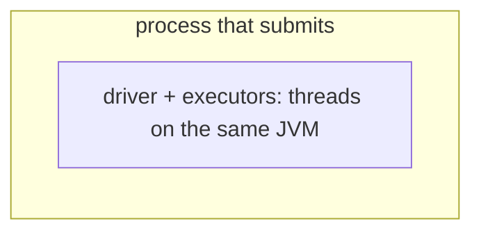
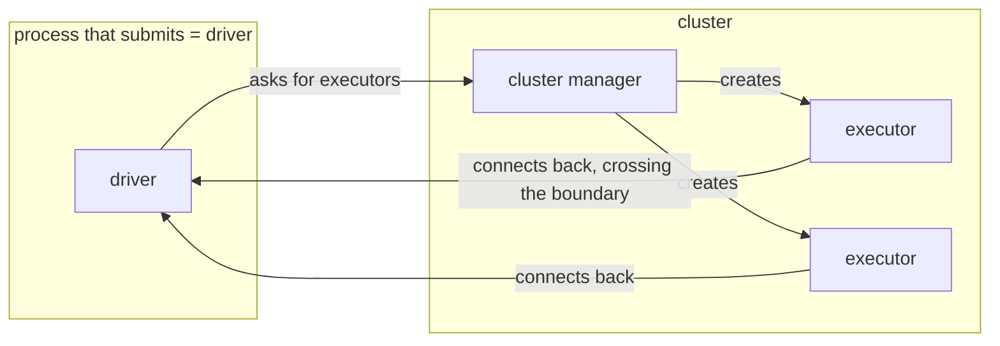
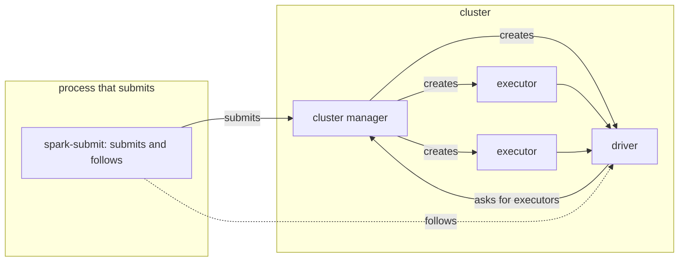

# 3. Deploy Modes

Deploy mode is **where the driver runs**. It seems like a configuration detail, but it is the choice that drags everything else: whether the driver is inside or outside the cluster changes who creates executor pods, by which path the network between them passes, which service account the permission comes from, where the log appears, and what remains of the job when the Airflow worker dies.

Before the table, a distinction that often gets tangled: **deploy mode** is where the driver runs (`local`, `client`, `cluster`); **cluster manager** is who delivers the resources (Kubernetes, Standalone, YARN). They are independent axes — the master is just the cluster manager address, and that is why the same column changes shape with Standalone without the modes changing.

| mode | driver runs | executors run | master |
|---|---|---|---|
| `local` | in the process that submits | in the same process (threads) | `local[*]` |
| `client` | in the process that submits | pods in the cluster | `k8s://https://kubernetes.default.svc.cluster.local:443` |
| `cluster` | pod in the cluster | pods in the cluster | `k8s://https://kubernetes.default.svc.cluster.local:443` |

### `local`

One box only. There is no network between driver and executor because there is no separate executor, there is no cluster manager in the middle — `local[*]` does not even address one — and there is no permission to ask. The ceiling is the memory of that process.

### `client`

The driver stayed outside and the executors, inside. The two back arrows now cross the boundary, and from there come the mode requirements: reachable driver address, fixed ports and headless Service. Since the driver is who asks for executors, the create-pod permission must be in whoever submits.

### `cluster`

After the first arrow, everything happens inside: no connection returns to whoever submitted, and the create-pod permission belongs to the driver, not to the submitter. The only link left is the dotted one — following. That is why the job continues when the submitter dies, and also why the driver log is no longer in your hands.

## Comparative

Assuming Kubernetes, and "who submits" being the Airflow worker:

| characteristic | `local` | `client` | `cluster` |
|---|---|---|---|
| driver | in the Airflow worker | in the Airflow worker | own pod in the cluster |
| executors | threads in the same process | pods | pods |
| who creates executor pods | nobody | the driver, from outside the cluster | the driver, from inside the cluster |
| driver↔executor network | does not exist | crosses the pod boundary: requires headless Service and fixed ports | resolved by Spark, everything inside the cluster |
| create-pod RBAC | none | in the worker service account | in the driver service account (`spark`) |
| if the Airflow worker dies | job dies | job dies with it | job **continues**, Airflow only loses tracking |
| driver log | in the task log | in the task log | in the driver pod, outside Airflow |
| startup | immediate | waits for executors | waits for driver pod + executors |
| worker weight | whole JVM, driver and executors | driver JVM | light, only supervises |
| dependencies | those of the Airflow image | driver uses Airflow's, executors use `SPARK_IMAGE` — **can diverge** | everything from `SPARK_IMAGE` |
| scale | one node | distributes | distributes |
| serves for | load one process can handle | intermediate load: distributes, but driver still weighs on worker | heavy load and long jobs |

The last line is about **load size, not environment**: the three run in production. What changes is how far each one holds and what you pay for it.

And "holds" is not a fixed Airflow number: with the KubernetesExecutor, CPU and memory of the task pod come from each task's `executor_config`, so whoever writes the DAG defines the worker size. See the `worker_resources` function in [dag_sparksubmitoperator.py](../../dags/dag_sparksubmitoperator.py), which requests different request per mode.

Three points worth highlighting:

**Cluster mode fault tolerance is less than it seems.** It is common to read that the cluster manager restarts the driver on another node preserving state — that is YARN with `maxAppAttempts`, not Kubernetes. Here, if the driver pod dies, the application dies and there is no automatic restart. Who retries is Airflow (submitting again, from scratch) or the Spark Operator via the CRD `restartPolicy` — and in both it is a new execution, not a continuation.

**Cluster mode decouples, and that cuts both ways.** The job surviving the worker's death is good, but if the task fails and Airflow tries again, the old job keeps running and you pay for two. It is worth checking that `spark-submit` was really interrupted before retrying.

**In client mode dependencies come from two places.** The driver uses the pyspark of the Airflow image and executors use `SPARK_IMAGE`. Different Spark versions between driver and executor do not talk — it is the most fragile of the three in that regard.

## When to use which

The criterion is load weight and what you are willing to pay in exchange. None of the three is a "test mode":

- **`local`** — load one process can handle. No extra pod, no network, immediate startup — for small aggregation or reading one partition this beats anything distributed. The ceiling is whatever memory the task requests in `executor_config`, with the whole JVM running inside that pod: it climbs until the largest node allows, and the bill is yours. In this range, [DuckDB](05-airflow-solutions.md#duckdb) often does the same faster and without JVM.
- **`client`** — intermediate load, when executors need to distribute but the driver still fits in the worker. The driver log goes to the task log and there is no wait for a driver pod. It costs headless Service, fixed ports and the risk of dependency divergence between the Airflow image and `SPARK_IMAGE`. [Spark Connect](04-connection-models.md) covers the same range — driver close, log at hand, low latency — without the back network.
- **`cluster`** — heavy load and long jobs. The only one that survives worker death, requires no back network to the driver and removes the JVM from the task pod. It pays with driver pod startup and log outside Airflow.

## References

- [Submitting Applications](https://spark.apache.org/docs/latest/submitting-applications.html) — `--master` and `--deploy-mode`
- [Master URLs](https://spark.apache.org/docs/latest/submitting-applications.html#master-urls) — the `local[*]`, `spark://`, `k8s://`, `yarn` table
- [Application Properties](https://spark.apache.org/docs/latest/configuration.html#application-properties) — `spark.driver.*`, `spark.executor.*` and the rest of the confs
- [`spark.kubernetes.*` confs](https://spark.apache.org/docs/latest/running-on-kubernetes.html#configuration)
- [Understanding Apache Spark Deployment Modes](https://freedium-mirror.cfd/https://blog.stackademic.com/understanding-apache-spark-deployment-modes-client-mode-cluster-mode-and-local-mode-bbfd1c7612fa)
- [Understanding Deployment Modes in PySpark](https://gaurav98095.medium.com/understanding-deployment-modes-in-pyspark-8031ddf7f5f3) — source of the diagrams above

---

[Cluster Managers ←](02-cluster-managers.md) · [Index](README.md) · [Next: Connection Models →](04-connection-models.md)
