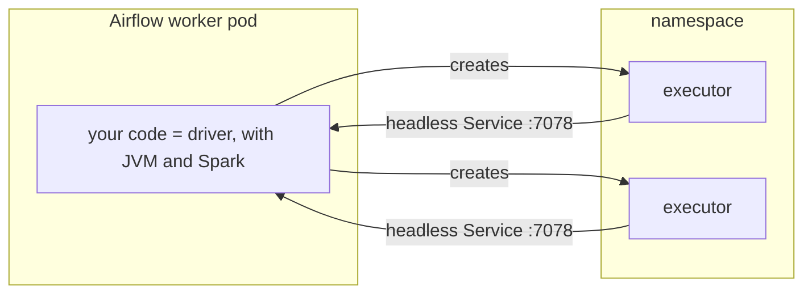
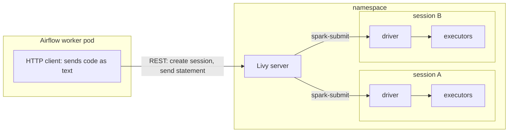
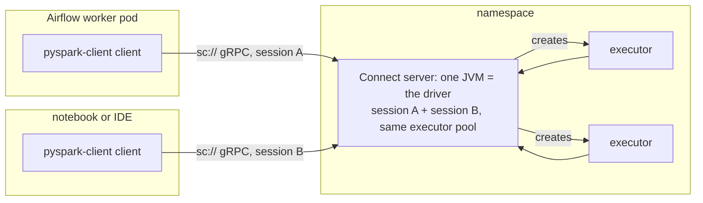

# 4. Connection Models

How the client gets the `SparkSession`: who hosts the driver and by which protocol you talk to it. Do not confuse with [deploy modes](03-deploy-modes.md), which is where the driver runs relative to the cluster.

The three sections below are in order of appearance, which is also the order in which the driver moved away from the client:

| model | who hosts the driver | protocol |
|---|---|---|
| traditional | your process | none, it is local |
| Livy | one driver per session | REST, code as text |
| Spark Connect | a long-lived server | gRPC, logical plan |

In the traditional model your code **is** the driver. That forces the client to have JVM, Spark and the right version, and forces executors to reach the client over the network. The other two exist to take the driver out of the client, and differ in how many drivers remain: one per session in Livy, one for all in Connect.

## Classic Client Mode

The driver runs in the process that submits — in our case, inside the Airflow worker pod. No server in the middle.

It requires Java and Spark on the Airflow image, and requires executors to reach the driver: headless Service, fixed ports and NetworkPolicy. Details in [deploy modes](03-deploy-modes.md).



Keep the back arrows: they cross the Airflow pod boundary and must be configured by hand. That is the nuisance the following two models eliminate.

## Apache Livy

REST gateway for Spark. You create a session over HTTP and send **code as text** (or submit a jar/py in batch mode); Livy runs `spark-submit` underneath and returns the statement result.

**Each session has its own driver.** Strong isolation, small blast radius — at the cost of paying driver startup per session.



Each session has its own box: an OOM in session A does not touch B, and each can have its own resource configuration. In exchange, the executor back arrows now end inside the cluster, not at the client. But a new session pays a full `spark-submit` before the first line runs.

The practical annoyance is the contract: you send a code string and receive text or JSON. There is no DataFrame at the client, so no autocomplete, type checking or decent stack trace.

It is a YARN-era tool — born for Zeppelin and Jupyter against Hadoop, and what EMR on EC2 installs. On Kubernetes support is weak and the project has had little movement for years.

## Spark Connect

A long-lived server is the driver. The client builds the query's logical plan and sends it over gRPC/protobuf; the server analyzes, optimizes, executes and returns the result in Arrow.

- client master: `sc://spark-connect.<namespace>.svc.cluster.local:15002`
- the server runs internally in client mode, with `spark.master=k8s://...`
- one server hosts **N sessions**, each with its own `SparkSession` — but all in the same JVM, sharing the same executor pool

The client is `pyspark-client`, a thin package without JVM. Since what travels is a plan and not a Java object, client and server can have different versions.



This is where it separates from Livy: there each session had its own box, here both are **inside the same** — separated logically, but in the same JVM and the same executor pool. Add per-session startup, and also subtract isolation. The back network still ends at the server, so the client keeps without headless Service and fixed port.

In code it is the same API, only how you point changes:

```python
SparkSession.builder.master("k8s://https://...").getOrCreate()          # driver = this process
SparkSession.builder.remote("sc://spark-connect...:15002").getOrCreate()  # driver = the server
```

Same class name, different thing behind: with `master()` the session creates a `SparkContext` and the process becomes the driver; with `remote()` it is only a client. That is why `spark.sparkContext` does not exist in Connect — there is no local context to expose, and consequently no RDD API.

Where it fits: it replaces [client mode](03-deploy-modes.md). It does not replace `cluster` mode. Today the safest fit is **development**: notebook and IDE pointing at a real cluster, without Spark on anyone's machine. For production on Kubernetes maturity is still low — sparse documentation and few production cases.

## Comparative

Two table columns ask for definition, because they stem from the same thing — the driver being disposable or long-lived:

**Isolation** is what falls together when something falls. `per job` and `per session` mean each has its own JVM and its own executors: an OOM or a hanging UDF brings down only who caused it. `weak`, in Connect, is the opposite — N sessions share the same JVM and the same executor pool, so a memory overflow takes neighboring sessions down with it.

**State between calls** is what survives from one execution to the next: temp views, DataFrames in `.cache()`, registered UDFs, the session catalog. In classic client mode each `spark-submit` is a new process — comes up, runs, dies — so nothing crosses: the next call does not know the previous one and pays startup again. In Livy and Connect the driver stays up waiting, so you cache in one call and read in the other; that is what allows notebook and REPL. "Per session" is literal: two sessions on the same Connect server do not see each other's temp views, even sharing JVM and executors. The bill comes from the other side — a session nobody closes holds executor and memory indefinitely.

| option | contract | driver | isolation | state between calls | maturity on k8s |
|---|---|---|---|---|---|
| classic client mode | `spark-submit` local | at the client itself | per job | no | ok, but requires Java |
| Apache Livy | REST, code as text | one per session | strong | yes, per session | weak, and project stalled |
| Spark Connect | gRPC, logical plan | one server for N sessions | **weak** — same JVM and same executors | yes, per session | **low** |

## When to use which

- **traditional** → production DAG. No server in the way, no state to manage.
- **Livy** → only if it already exists in the environment.
- **Spark Connect** → development: notebook and IDE against a real cluster, without Spark on anyone's machine. For many small tasks in Airflow it would solve startup latency, but with shared driver — validate before depending.

Pros, cons and Connect dependencies from the Airflow point of view in [solutions](05-airflow-solutions.md#spark-connect); the choice among all options, at [conclusion](06-conclusion.md).

## References

- [Spark Connect Overview](https://spark.apache.org/docs/latest/spark-connect-overview.html)

---

[Deploy Modes ←](03-deploy-modes.md) · [Index](README.md) · [Next: Solutions →](05-airflow-solutions.md)
