# 5. Solutions in Airflow

Each solution is a combination of: who submits, where the driver is born, and what remains for the Airflow worker pod to do.

## Modes each one supports

| solution | local | client | cluster | who submits |
|---|:-:|:-:|:-:|---|
| EMR on EKS (`EmrContainerOperator`) | ✗ | ✗ | ✓ | EMR API |
| Spark Operator kubeflow (`SparkKubernetesOperator`) | ✗ | ✗ | ✓ | controller in the cluster |
| Spark Operator from Apache (the same `SparkKubernetesOperator`, with `api_group` changed) | ✗ | ✗ | ✓ | controller in the cluster |
| `SparkSubmitOperator` | ✓ | ✓ | ✓ | Airflow worker |
| `KubernetesPodOperator` | ✓ | ✓ | ✓ | dedicated pod with Spark image |
| `PythonOperator` | ✓ | ✓ | ✗ | Airflow worker |
| Spark Standalone | ✗ | ✓ | ✓ | standalone master |
| DuckDB (`PythonOperator`) | — | — | — | not Spark: no driver and no executor |

DuckDB enters the table without a deploy mode because it has none: it is an embedded engine in the Python process, there is no driver or executor to position. It remains a candidate for every job that fits on one node — see [its design and limits](#duckdb).

## How to read each section

Each solution below brings the architecture drawing, a **datasheet** with the four axes that usually decide the choice, and the pros and cons.

On the datasheet's dependencies line, three layers that are often confused as one:

1. **Client** — what the Airflow image needs to be able to submit: provider, `pyspark`, Java. "Airflow image" here is not the official base: it is the one you build from it. Installing Java and Spark is one more layer in the Dockerfile, not a modification of the base — and with `pod_override` you can use that image only for the tasks that need it, leaving the rest of Airflow light. The real cost is not "dirtying the base", it is keeping that layer's version married to the cluster's.
2. **Job** — the Spark version and libraries the driver and executors actually use.
3. **Granularity** — who decides the version: the job, the project or the whole platform. When the first two layers exist, they must be compatible, and not always who touches one commands the other.

The comparison of all of them and the decision tree are at [conclusion](06-conclusion.md).

## EMR on EKS

The worker only calls the API. Who materializes the driver is the EMR service.

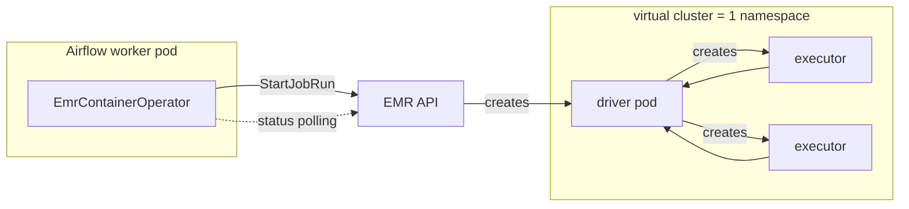

No Java on the worker. The driver log goes to S3, not to the task log.

**Datasheet:**

- **operation and maintenance:** **low per job, medium per platform**. No controller to install nor Spark image to maintain — that is AWS's. What remains scales with the organization: one virtual cluster per namespace, each with its IAM role, its RBAC and its job execution roles, and all of that registered again per EKS cluster. It is not continuous work, but it is work that grows with every new project.
- **engineer usage:** medium — the job becomes a job driver JSON, and the API blocks part of the confs
- **cost:** high — EMR uplift per vCPU/hour on top of what you already pay for EKS
- **dependencies:** Spark version comes from `release_label`; job libraries live in the EMR image, in a custom derived from it or in `--packages`; granularity **per job run**; the Airflow image needs nothing

Pros:

- AWS manages the image and Spark version
- IAM per job execution role: credential per job, no service account in the cluster
- isolation per job

Cons:

- cluster mode only
- locked into EMR
- extra charge per vCPU/hour on top of what you already pay for EKS
- driver log only in S3, outside the task log: you have to leave Airflow to debug
- the API blocks master, deploy mode and part of the confs
- one virtual cluster serves a single namespace: for namespace per project and cost allocation, one virtual cluster per namespace, each with its own IAM role and RBAC

## Spark Operator (kubeflow or Apache)

These are **two different operators with the same name** along the way, and that is where the confusion lies:

- the Airflow one is `SparkKubernetesOperator`, from the `cncf-kubernetes` provider. It only writes a `SparkApplication` object to Kubernetes and follows it.
- the Kubernetes one is the controller installed in the cluster — kubeflow's or Apache's. It is the one that observes that object and materializes driver and executors.

The drawing below applies to both controllers: `SparkKubernetesOperator` is the same, and so is the architecture. What changes is which CRD it writes — `sparkoperator.k8s.io/v1beta2` in kubeflow (which the provider assumes by default) or `spark.apache.org` in Apache, which requires pointing `api_group` and `api_version` on the task. See [notes](#notes).

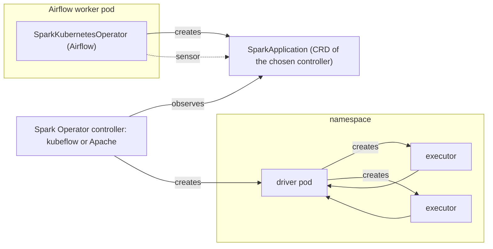

No Java on the worker. The RBAC the worker needs is to create `SparkApplication`, not pod.

**Datasheet:**

- **operation and maintenance:** medium in kubeflow — one controller to install, update and monitor. Medium/high in Apache: same controller, but new and with little material to rely on
- **engineer usage:** medium — the job becomes a CRD YAML, outside Python; in Apache, plus the `api_group`/`api_version` tuning
- **cost:** low — only EKS compute
- **dependencies:** Spark version comes from the `image` field in the CRD; job libraries live in the pointed image; granularity **per `SparkApplication`**; the Airflow image needs nothing

kubeflow pros:

- declarative via CRD
- own retry and scheduling
- isolation per job
- large community, and the path the Airflow provider takes

kubeflow cons:

- one more piece to operate
- job becomes YAML, outside Python

Apache pros:

- same CRD benefits
- it is the official Spark project operator

Apache cons:

- new and little moved
- small community and material
- in the provider, requires pointing `api_group` and `api_version` by hand

## `SparkSubmitOperator`

**Datasheet:**

- **operation and maintenance:** high — a derived Airflow image with Java and Spark, marrying its version with the cluster's, RBAC and networking on your own
- **engineer usage:** the greatest ease — everything in Python, inside the DAG
- **cost:** low — only EKS compute
- **dependencies:** in cluster mode, client version comes from the provider and job version from `SPARK_IMAGE` (job per task, single client); in client and local, the driver uses the Airflow image and executors use `SPARK_IMAGE`, so granularity is **platform-level**. The Airflow image needs provider, `pyspark` and Java

Pros:

- the three deploy modes
- total conf control
- **one image only per project** — the Airflow-derived one with Java and Spark, built by the image pipeline projects already have, with no new process

Cons:

- requires Java and Spark on the Airflow image — a derived layer from the base, which bloats the image used in `executor_config`, including in tasks that are not Spark
- client version must match cluster version
- RBAC to create pod on the worker service account (in client mode)

**Two sources of truth.** The client version comes from the `apache-airflow-providers-apache-spark` provider, which drags `pyspark` along — who commands it is whoever maintains the Airflow image, that is, the platform. The job version comes from `SPARK_IMAGE` in the DAG, which is the project's. The two must match, and nobody holds both. In compensation it is the standard and supported path: you invent nothing, and a `pip install` of the provider solves the client.

### `SparkSubmitOperator` in cluster mode

`spark-submit` runs inside the worker, but only to submit: the driver is born as a pod.

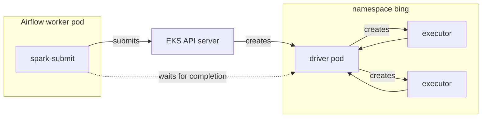

Requires Java on the worker. If the worker dies, the job continues.

### `SparkSubmitOperator` in client mode

Here the worker **is** the driver. It is the only case where the executor back arrow crosses the Airflow pod boundary.

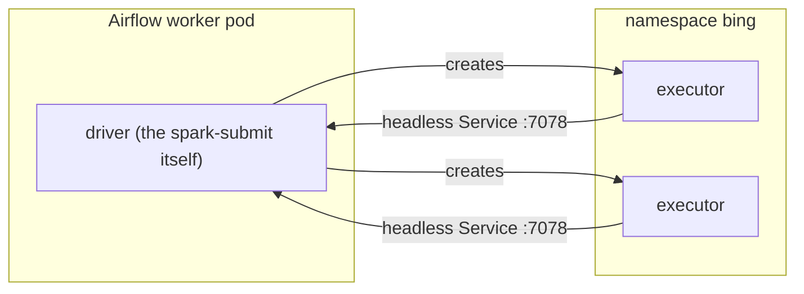

Requires Java, create-pod RBAC on the worker SA, and a headless Service pointing to the worker pod. If the worker dies, the job dies.

### `SparkSubmitOperator` in local mode

Nothing leaves the pod.

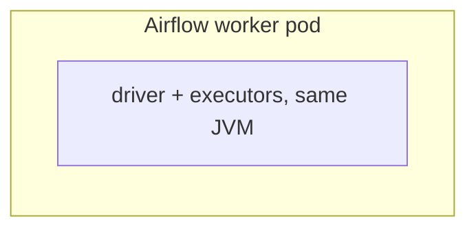

## `KubernetesPodOperator`

**Datasheet:**

- **operation and maintenance:** medium — nothing on the Airflow image, but the pod and command are yours, and the project ends up maintaining **two** images
- **engineer usage:** low — you assemble `spark-submit` by hand, without parsed status
- **cost:** low — only EKS compute
- **dependencies:** Spark version is that of the image you choose, and job libraries live in that image; granularity **per task**; the Airflow image needs nothing

Pros:

- isolated Spark image, nothing on the Airflow image
- Spark version decided per task, without touching the platform

Cons:

- you assemble `spark-submit` by hand
- no parsed job status
- **two images per project** — see below

**The image count.** "Nothing on the Airflow image" is true only on the platform side. On the project side, the KPO task keeps running in an Airflow pod, with the `executor_config` image — and now there is a second image, the Spark one, which the pod created by the operator executes. Two build chains, two places to version, and the second one is outside the build process Airflow projects already have.

The alternative is an intermediate image: Airflow base, plus Java and Spark. It bloats the image that goes into `executor_config` — including in non-Spark tasks, if it is the same for all — but it is **one image only**, built by the pipeline that already exists, with no new process. For most projects this tradeoff pays off: the cost is image size, and KPO's is permanent build and versioning complexity.

Add to that what is already in the cons — hand-assembled command, no parsed status — and KPO ends up worth it mainly when Spark version really needs to vary per task, or when having Spark on the Airflow image is vetoed for another reason.

### `KubernetesPodOperator` in cluster mode

`spark-submit` leaves the worker and goes to a pod with the Spark image. No Java on the Airflow image.

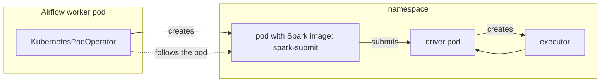

Note the extra pod: one just to submit. That is the cost of not having Spark on the Airflow image.

### `KubernetesPodOperator` in client mode

The pod created by the operator **is** the driver — `--deploy-mode client` running inside it. The difference from client mode of `SparkSubmitOperator` is where this driver lives: here in a dedicated pod with the Spark image, which is born and dies with the task, and not inside the Airflow worker.

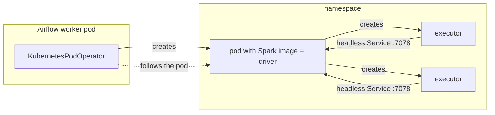

The back network still exists, but it no longer crosses the Airflow boundary: the headless Service points to the KPO pod, and the create-pod RBAC stays on its service account. The annoying part is that this pod is ephemeral — the Service needs a stable label to match it, and `spark.driver.host` must point to that Service's name. If the pod dies, the job dies with it, because the driver was inside.

### `KubernetesPodOperator` in local mode

One pod only, with the Spark image, driver and executors on the same JVM. No executor pod, no network between them, no RBAC beyond creating the pod itself.

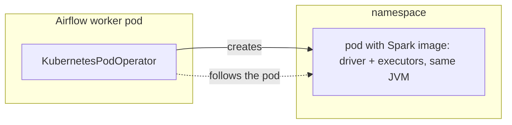

It is `SparkSubmitOperator`'s local mode with the JVM outside the worker. What changes in practice: sizing is the pod's and not the Airflow worker's, and dependencies are those of the Spark image. It costs the pod startup.

## `PythonOperator`

**Datasheet:**

- **operation and maintenance:** high — same image pain as `SparkSubmitOperator`
- **engineer usage:** the greatest — pure Python code, no YAML and no CLI
- **cost:** low per job, bad at scale — the worker grows along with the data
- **dependencies:** Spark version is that of the `pyspark` you install, and job libraries live in the Airflow image; granularity **platform-level**, or per project if you keep images; the Airflow image needs `pyspark` and Java

Pros:

- no YAML and no CLI, pure Python code

Cons:

- driver inside the Airflow worker
- does not scale
- same image and networking pain as `SparkSubmitOperator`

**Flexibility has an address.** You choose whichever `pyspark` version you want — but it lives on the Airflow image, which is shared. To have a version per project it is `pod_override` with **another Airflow image** (not the Spark one), which means maintaining N Airflow images. To isolate only Python libraries, `ExternalPythonOperator` or virtualenv per task solve it without a new image. It is the opposite extreme of EMR: nothing is standardized, everything is possible, and maintenance is yours.

### `PythonOperator` in client mode

The `SparkSession` created in the Python process **is** the driver. That is why there is no cluster mode here.

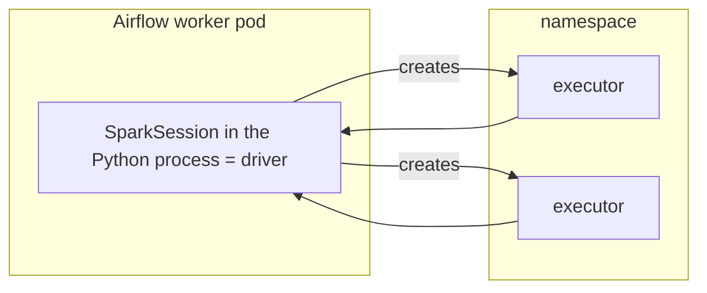

Same drawing as `SparkSubmitOperator`'s client mode, and the same requirements: Java, RBAC and back network to the driver.

### `PythonOperator` in local mode

`SparkSession.builder.master("local[*]")`: same session, without leaving the pod.

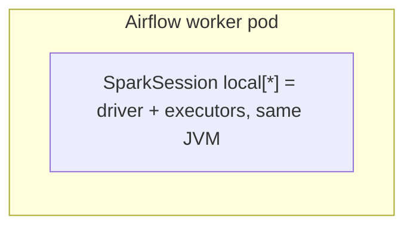

Same drawing as `SparkSubmitOperator`'s local mode — the only difference is who brings up the JVM: `SparkSession.builder` in your code, instead of `spark-submit`. It still requires Java on the Airflow image, and in this load range it is worth comparing with [DuckDB](#duckdb), which does the same without JVM.

## Spark Standalone

**Datasheet:**

- **operation and maintenance:** high — master and workers to operate, scale and update
- **engineer usage:** medium — normal `spark-submit`
- **cost:** high — cluster parked 24/7 at peak size
- **dependencies:** Spark version is that installed on the workers, and job libraries live in the environment of those long-lived workers; granularity **one for all**; the Airflow image needs `pyspark` and Java

Pros:

- simple, does not depend on Kubernetes API nor RBAC
- hot cluster, no startup wait

Cons — **unviable in practice:**

- resource parked 24/7, dimensioned for the peak
- no autoscaling and no pod per job: Kubernetes becomes only a host, you harvest nothing from it
- no isolation between jobs
- no request/limit, node selector or spot per workload
- one more master to operate

### Spark Standalone in client mode

Here the cluster manager is not Kubernetes: standalone master and workers are already up, and the master is `spark://spark-master.<namespace>.svc.cluster.local:7077`. The driver continues to be `spark-submit` inside the Airflow worker.

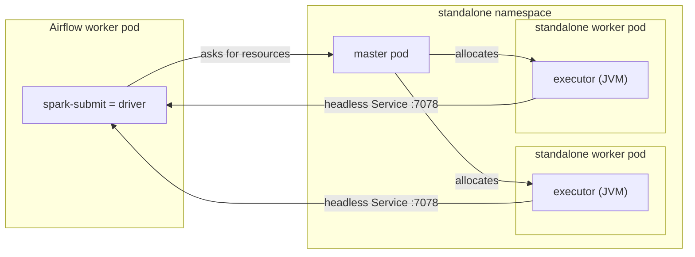

Notice that **no pod comes up per job**: what is born is an executor JVM inside a pod that already existed. Who allocates is the standalone master, so there is no create-pod RBAC — but the price is the parked cluster waiting. Java on the Airflow worker and back network to the driver remain mandatory, same as Kubernetes client mode.

### Spark Standalone in cluster mode

`spark-submit` only delivers the job to the master; the driver becomes one more JVM inside a standalone worker pod.

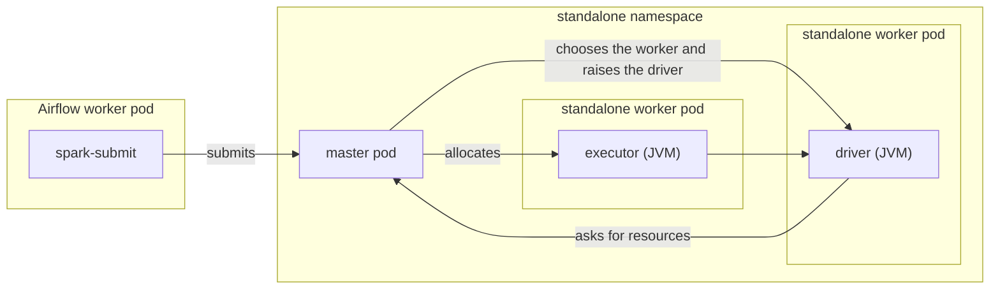

As in Kubernetes cluster mode, the job survives the Airflow worker's death and the driver↔executor network stays entirely inside the cluster. The difference is that there is no pod per job: drivers and executors of all jobs share the same long-lived worker pods, without request, limit or node selector per workload.

## Spark Connect

The driver is already up, outside the task. The worker only talks over gRPC.

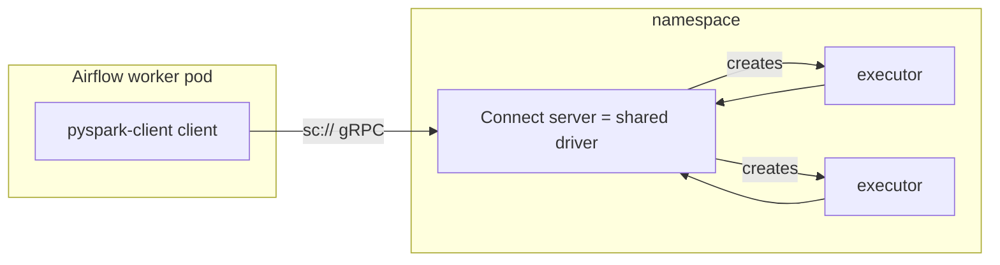

No new pod per task, no Java on the worker, no RBAC. In exchange, the driver is shared by all sessions. How the client talks to it is at [connection models](04-connection-models.md#spark-connect).

**Datasheet:**

- **operation and maintenance:** high — long-lived server, without HA, and all projects' Python environment in the same place
- **engineer usage:** the greatest — `SparkSession.builder.remote(...)` and done
- **cost:** medium — server up even when idle
- **dependencies:** Spark version is that of the server, and libraries live in its environment and its executors'; granularity **one for all**; the Airflow image needs only `pyspark-client`

Pros:

- thin client, without Java
- no driver↔executor network to configure
- no RBAC on the worker
- no startup wait
- great for development environments

Cons:

- little maturity on Kubernetes: sparse documentation and almost no production cases
- single point of failure: a crash takes down all sessions
- one single Python environment for all projects
- no isolation per job
- parked cost

`spark.addArtifact()` sends `.py`, `.zip` and `.jar` per session and eases the simple dependency case, but does not solve conflicting versions of the same package.

## DuckDB

There is no piece at all to position: the engine runs inside the task's Python process.

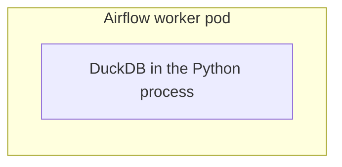

Compare with the `local` mode drawing: same format, without JVM and without `spark-submit`. It is `pip install duckdb` and a `PythonOperator` — no master, no connection, no Spark image, no RBAC. It comes up in milliseconds instead of seconds, and the task pod stays small. Reads Parquet, CSV, JSON and Iceberg from S3 via `httpfs`, authenticating with IRSA.

It enters this list because it occupies the same place as `local` mode, and in practice much of `client`: a job that did not need to be distributed.

**Datasheet:**

- **operation and maintenance:** the smallest — one Python library, nothing to operate
- **engineer usage:** the greatest — SQL or Python, no cluster in the way
- **cost:** the smallest — one pod, no JVM and no executors
- **dependencies:** no Spark; the library lives on the Airflow image or in a venv per task; granularity platform-level, or **per task** with venv; the Airflow image needs only `duckdb`

Pros:

- nothing to operate: it is a Python library
- no JVM, no master, no connection, no RBAC
- millisecond startup and small pod
- the lowest cost on the list

Cons:

- **single node** — does not distribute and has no executor: heavy join at TB scale or big shuffle ask for Spark
- **does not write Hudi** — that is Spark, period (see the commented job in [dag_emr_eks.py](../../dags/dag_emr_eks.py))
- **does not reuse PySpark DataFrame code** — SQL migrates easily, the DataFrame API does not

Outside those cases, a big pod with DuckDB usually beats a distributed Spark up to the hundreds of GB range, because it does not pay shuffle nor serialization between executors. Hence the practical rule: if the data fits on one node, DuckDB; if it does not, Spark in cluster mode. `local` mode remains valid for a job already written in Spark — for new code in this range, DuckDB delivers the same without JVM.

**To validate before adopting.** The tipping point depends on format, shuffle and node size — there is no universal number. It is worth measuring with a real job of yours, comparing DuckDB on a big pod against the same job in cluster mode: time, cost and memory peak. Also test S3 reading with IRSA and behavior when data exceeds RAM (DuckDB spills to disk, but needs a volume and `memory_limit` configured). Documentation at [duckdb.org](https://duckdb.org/docs/).

## What each solution charges the Airflow worker

The drawings above show where the pieces are. This table is the same information from Airflow's side: what remains for the task pod to do, and what the platform must provision for it to work.

| solution | worker role | pods that come up in the cluster | Java on worker | create-pod RBAC on worker SA |
|---|---|---|:-:|:-:|
| EMR on EKS | only calls EMR API and polls | driver + executors, in the virtual cluster namespace | no | no |
| Spark Operator (kubeflow or Apache) | only creates the CRD and polls (sensor) | driver + executors, created by the controller | no | no, but needs to create `SparkApplication` |
| `SparkSubmitOperator` in `cluster` | only the submitter: fires and follows | driver + executors | yes | no (who creates is the driver, with `spark` SA) |
| `SparkSubmitOperator` in `client` | is the driver, and itself creates executor pods | executors | yes | **yes** |
| `SparkSubmitOperator` in `local` | driver **and** executors, all in one JVM inside the pod | none | yes | no |
| `KubernetesPodOperator` | only creates a pod and follows | the Spark image pod, plus what its mode asks: driver and executors in `cluster`, executors in `client`, nothing in `local` | no | yes (creating the pod) |
| `PythonOperator` in `client` | is the driver: its own process's `SparkSession` | executors | yes | **yes** |
| `PythonOperator` in `local` | driver and executors in its own process JVM | none | yes | no |
| Spark Connect | only gRPC client | no new pod: uses the server already up | no | no |
| Spark Standalone | the driver (`client`) or only the submitter (`cluster`) | no new pod: uses long-lived worker pods already up | yes | no |
| DuckDB | processes everything inside the pod, no JVM | none | no | no |

Two readings the table does not deliver for free:

**The worker gets heavy whenever the driver lives in it** — `local` and `client`, both in `SparkSubmitOperator` and `PythonOperator`. In the other cases it only supervises and can be small.

This is sizing, not a limit: with the KubernetesExecutor, CPU and memory of the task pod come from the task's own `executor_config`, via `pod_override`. Each task asks for its own, and a heavy job in `local` mode is just a bigger `executor_config` — the ceiling becomes the largest available node and how much you want to pay for it. That is what the `worker_resources` function in [dag_sparksubmitoperator.py](../../dags/dag_sparksubmitoperator.py) does, requesting `2G` locally, `3G` in client (driver inside the worker in both) and `1G` in cluster, where it only supervises.

**In `client` RBAC changes hands.** Who creates executor pods is the driver, and the driver is the worker — so the permission must be on its service account, and `spark.kubernetes.authenticate.driver.serviceAccountName` is ignored.

## Notes

There are **two** Spark Operators. The [kubeflow](https://github.com/kubeflow/spark-operator) one (CRD `sparkoperator.k8s.io/v1beta2`) is the de facto one, and is what the `SparkKubernetesOperator` provider assumes by default. The [Apache](https://apache.github.io/spark-kubernetes-operator/) one (CRD `spark.apache.org`) is official by name, but new and with little movement — to point the provider at it, swap `api_group` and `api_version` on the operator.

Standalone is the exception in the table: the master is not `k8s://`, but `spark://spark-master.<namespace>.svc.cluster.local:7077`. It ignores the Kubernetes scheduler — executors are JVMs inside long-lived worker pods, not one pod per job.

`PythonOperator` does not do cluster mode: the `SparkSession` created in the Python process is the driver, so by definition it is client or local. Only by calling `spark-submit` via subprocess — and then it is a worse `SparkSubmitOperator`.

`SparkSubmitOperator` and `PythonOperator` require Java + Spark on the Airflow image — not on the official base, but on a derived one you maintain, applicable only to tasks that need it via `pod_override`. The other three dispense with this entirely.

## References

In the repo:

- [dag_emr_eks.py](../../dags/dag_emr_eks.py) — EMR on EKS, cluster mode
- [dag_sparksubmitoperator.py](../../dags/dag_sparksubmitoperator.py) — the three modes side by side
- [dags_tests_spark/](../../dags/dags_tests_spark/) — Spark Operator

Operators and providers:

- [apache-spark provider](https://airflow.apache.org/docs/apache-airflow-providers-apache-spark/stable/index.html) — `SparkSubmitOperator` and the connection
- [cncf-kubernetes provider](https://airflow.apache.org/docs/apache-airflow-providers-cncf-kubernetes/stable/index.html) — `SparkKubernetesOperator` and `KubernetesPodOperator`
- [kubeflow Spark Operator](https://github.com/kubeflow/spark-operator)
- [Apache Spark Kubernetes Operator](https://apache.github.io/spark-kubernetes-operator/) — [repo](https://github.com/apache/spark-kubernetes-operator)
- [EMR on EKS](https://docs.aws.amazon.com/emr/latest/EMR-on-EKS-DevelopmentGuide/emr-eks.html)
- [apache/spark-docker](https://github.com/apache/spark-docker) — where `SPARK_IMAGE` tags come from, with Dockerfiles for each variant

---

[Connection Models ←](04-connection-models.md) · [Index](README.md) · [Next: Conclusion →](06-conclusion.md)
