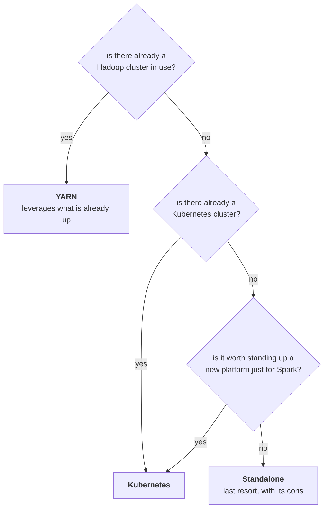
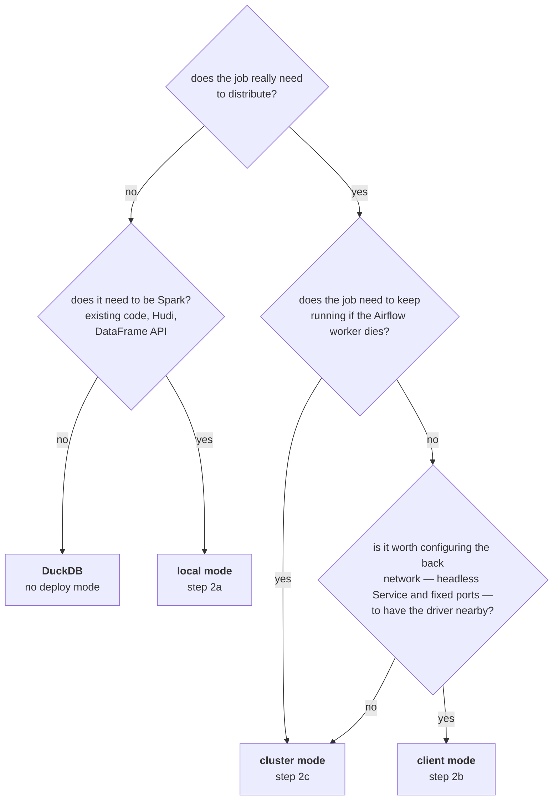
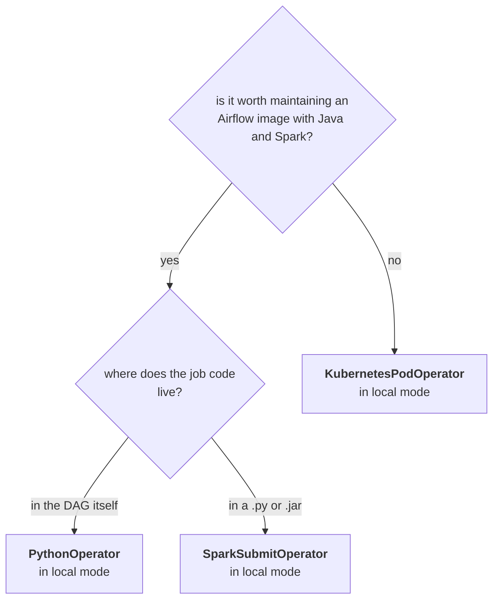
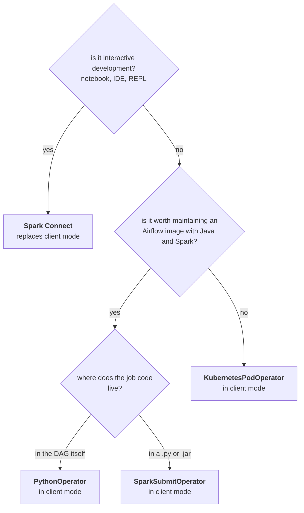
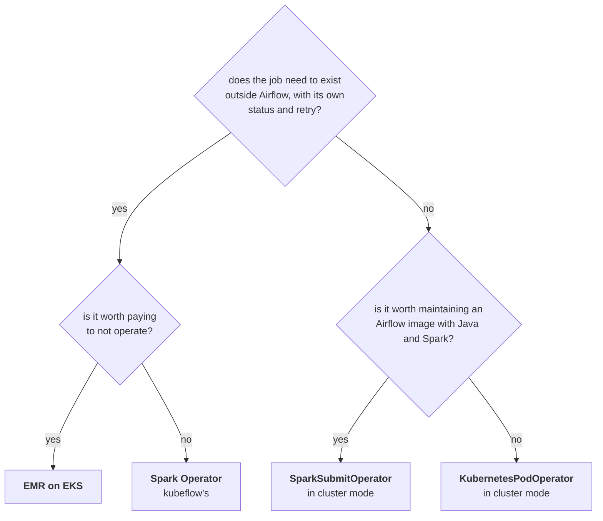

# 6. Conclusion

What each solution is, how much it costs and what it charges the worker is at [solutions](05-airflow-solutions.md), one datasheet per section. This page puts it all together and answers the only remaining question: which to choose.

Summarizing those datasheet axes: who wants **less operation** goes with EMR on EKS and pays for it; who wants **lower cost** goes with Spark Operator and pays in YAML and one more controller; who wants **engineer ease** goes with `SparkSubmitOperator` or Spark Connect and pays in Airflow image or shared server.

The choice comes in stages, and mixing the three is what usually stalls the decision: **first the cluster manager, then the deploy mode, and only then the solution that delivers that mode**. The trees below follow that order.

## Decision tree

### Step 0: which cluster manager

This step almost always comes answered by what the company has: standing up Hadoop today means creating a second platform to operate, and Standalone pays for a parked cluster dimensioned for the peak. [Here it is Kubernetes](02-cluster-managers.md#why-kubernetes-here), because EKS already exists and already runs Airflow — the rest of this page assumes that.

### Step 1: which deploy mode

The `client` mode only appears when you **actively accept** the back network in exchange for having the driver nearby: log on the task, no wait for a driver pod. If that trade does not interest you, cluster mode does the same without the network — that is why it is the destination of two branches.

### Step 2a: `local` mode, which operator

The three run the same thing — driver and executors in a single JVM. The difference is where that JVM lives: in the task pod (`PythonOperator` and `SparkSubmitOperator`, sized by `executor_config`) or in a separate pod with the Spark image (`KubernetesPodOperator`, which costs that pod's startup).

### Step 2b: `client` mode, which option

Spark Connect delivers what client mode has good — driver nearby, log at hand, low latency — without headless Service nor fixed port, but [its maturity on Kubernetes still does not sustain production](05-airflow-solutions.md#spark-connect). In `KubernetesPodOperator`, the back network still exists; it only stops crossing the Airflow boundary, because the driver becomes the KPO pod.

### Step 2c: `cluster` mode, which solution

Spark Standalone is the only one that appears in no branch, neither here nor in the other trees: it works, but its [cons](05-airflow-solutions.md#spark-standalone) take it off all paths.

## The questions that repeat

Three questions appear in more than one tree, because they are orthogonal to deploy mode.

**Does the job really need to distribute?** Distributing serves two things: processing more data than one machine holds, and parallelizing heavy shuffle and join. A job that reads partitions, aggregates and joins a small table does neither — in that case, distributing adds pod, startup and network without returning anything. And pod size is your decision: with the KubernetesExecutor, CPU and memory come from each task's `executor_config`, so "it did not fit on the worker" is almost never the answer; the ceiling is the cluster's largest node and how much you want to pay for it.

**Is it worth maintaining an Airflow image with Java and Spark?** Nobody touches the base image: it is a derived one, and `pod_override` allows using it only for Spark tasks. The question is not whether it can be done — it can, and it is a Dockerfile — but what you prefer to pay. On one side, one image per project, built by the pipeline that already exists, which bloats and whose version must track the cluster's. On the other, `KubernetesPodOperator`: no Spark on Airflow, but [two images per project](05-airflow-solutions.md#kubernetespodoperator), two build chains and hand-assembled `spark-submit`. For most projects the first is cheaper; the second wins when Spark version needs to vary per task.

**Does the job need to exist outside Airflow?** That is: when the task ends, does any record of that execution remain somewhere else?

- **No** → `KubernetesPodOperator` or `SparkSubmitOperator`. The job is a pod running `spark-submit`; who knows it existed is Airflow, and no one else. Retry is task retry, status is task status.
- **Yes** → Spark Operator or EMR on EKS. In the operator, the task creates a `SparkApplication`, a Kubernetes object with a life of its own: you can `kubectl get` it, it has status, and the CRD `restartPolicy` redoes the job without Airflow in the middle. In EMR, the equivalent is the job run on the API, with history and retry on AWS's side.

This matters when **something other than Airflow needs to see or control the job** — a team that follows via `kubectl`, a retry policy that is not the DAG's, a cluster job inventory. If Airflow is the only owner, this layer is just one more piece to maintain.

## Dependencies: two families

A fourth question splits the list in two, and the split is not technical — it is about who decides.

**Per-job image is the only scheme where projects do not negotiate.** EMR on EKS, Spark Operator and `KubernetesPodOperator` decide the version within the job definition. Two teams can run Spark 3.5 and 4.2 on the same cluster, on the same day, without talking. Nothing of that touches the Airflow image.

**Single environment is permanent negotiation.** In Spark Connect and Standalone there is a single Python environment for all projects. Raising a library version becomes a collective decision. `PythonOperator` and `SparkSubmitOperator` are in the middle: the version is yours, but it lives on the Airflow image, which is the whole project's.

**Rule:** if "each project with its own dependencies" is a requirement, the scheme is per-job image. The others ask for a commonly negotiated environment.

## What this means here

EKS is already up and already runs Airflow, so step 0 ends in Kubernetes, and step 1 ends in `cluster` mode for anything that needs to distribute. The remaining choice is step 2c, and it resolves in two accounts: how much it costs to maintain an Airflow image with Java and Spark married to the cluster's, and how much it is worth to have the job existing outside Airflow.

Before any of those, though, the tree's first question is worth asking. A good part of today's Spark jobs do not need to distribute, and [DuckDB](05-airflow-solutions.md#duckdb) is cheaper on all axes — which requires measuring with a real job of yours before deciding.

To compare the modes in practice, [dag_sparksubmitoperator.py](../../dags/dag_sparksubmitoperator.py) runs the three side by side without changing operator.

---

[Solutions ←](05-airflow-solutions.md) · [Index](README.md) · [Next: Session Sizing →](07-sessionsizing.md)
