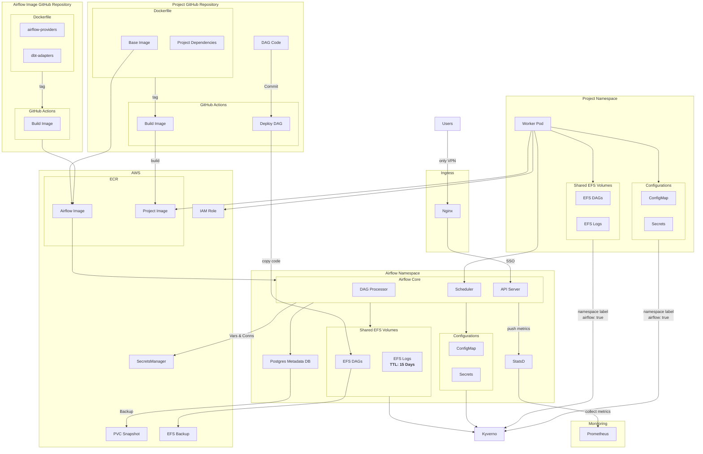

# Airflow on Kubernetes

Apache Airflow workflow orchestration running on Kubernetes. This area covers DAG lifecycle, quality assurance, observability, migration, and operational governance for data batch workflows.

## Orchestration & Pipelines

- [Data Batch Workflow Orchestration with Apache Airflow on Kubernetes](../airflow.md)
- [CI/CD Pipelines for Airflow Projects: DAG Code Releases and Image Build with GitHub Actions](cicd-airflow.md)
- [Airflow DAG Migration & Pipeline Modernization](migration.md)

## DAG Quality & Governance

- [Airflow DAG Cleanup, Organization and Ownership Governance](../airflow-dags-cleanup.md)
- [Standardized Airflow Failure Notifications through Cluster Policy Mutation](../airflow-failure-notifications.md)
- [Airflow DAGs Quality and Governance Policies](policies.md)

## Observability & Operations

- [Standardized Monitoring and Alerting for Airflow & Kafka Applications](../../observability/data-platform-applications.md)
- [Airflow Observability](observability.md)

## Infrastructure & Resources

- [Airflow on Kubernetes](kubernetes.md)
- [Airflow Operator](airflow-operator.md)
- [Airflow API](api.md)
- [DAGs Maintenance](dags-maintenance.md)
- [Shared Storage via Amazon EFS](efs.md)
- [Airflow Resources](recursos.md)
- [Airflow Secret Backend](secret-backend.md)
- [Airflow Spot Instances](spot.md)
- [Airflow SSO](sso.md)
- [Other Airflow Topics](others.md)

## Architecture

---

> **See also:** [Data Engineering](../README.md) for the parent data engineering overview, [DevOps](../../devops/README.md) for CI/CD pipelines, [Observability](../../observability/README.md) for monitoring, and [Platform Engineering](../../platform-engineering/README.md) for Helm charts and cluster tooling.
