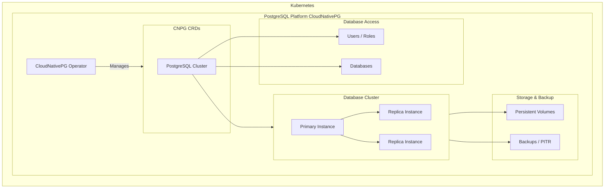

# PostgreSQL on Kubernetes with CloudNativePG

## Problem
- Operational Complexity: Running PostgreSQL in Kubernetes without a dedicated operator leads to fragile setups and high operational overhead.

- High Availability Challenges: Manual configuration of replication, failover, and backups is error-prone and hard to maintain.

- Inconsistent Database Standards: Different teams deploy PostgreSQL clusters with varying configurations, impacting reliability and security.

- Limited Day-2 Operations: Tasks such as upgrades, scaling, backup validation, and recovery are difficult to automate.

- Observability Gaps: Lack of standardized monitoring and alerting for PostgreSQL running in Kubernetes environments.

## Solution
- PostgreSQL Operator Adoption: Designed and deployed PostgreSQL clusters using CloudNativePG (CNPG) as the Kubernetes-native operator.

- Declarative Database Management: Managed PostgreSQL clusters, users, databases, and extensions using declarative Kubernetes manifests.

- High Availability by Default: Implemented multi-instance PostgreSQL clusters with synchronous/asynchronous replication and automated failover.

- Backup & Recovery Strategy: Configured continuous backups and point-in-time recovery (PITR) using object storage, ensuring data durability.

- Secure-by-Design Setup: Enforced TLS, role-based access control, and least-privilege database users.

- Automated Lifecycle Operations: Performed rolling upgrades, scaling, and configuration changes with zero or minimal downtime.

- Kubernetes-Native Observability: Integrated PostgreSQL metrics and logs with Prometheus and centralized logging solutions.

- Standardized Database Platform: Established a reusable, production-ready PostgreSQL blueprint for multiple teams and workloads.

- Team Autonomy with Guardrails: Enabled application teams to provision and manage databases without direct access to cluster internals.

## Architecture

## Skills

- Databases

- Site Reliability Engineering

- Platform Engineering

- DevOps

## Tools

- CloudNativePG

- PostgreSQL

- Kubernetes

- Prometheus

- Grafana

- Amazon S3

- Helm

- Flux
