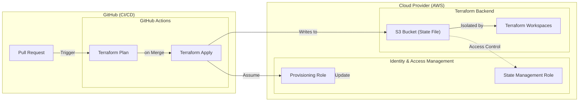

# Project
 
## Overview
A standardized Terraform CI/CD implementation that runs `plan` on PR and applies reviewed changes on merge, with isolated state and scoped permissions.
 
The intent is to make infrastructure delivery:
- consistent across repositories

- safe (state isolation, concurrency controls)

- auditable (apply traceable to an approved PR)
 
## Key Design Points
- Plan artifact integrity between PR and merge.

- Environment isolation via workspaces/tfvars and backend paths.

- Concurrency controls to avoid conflicting runs.
 
## End-to-End Flow
- **PR**
  - `terraform fmt -check`

  - `terraform validate`

  - `terraform plan` with explicit environment inputs

  - Store a plan artifact with a stable identity (e.g., run id + commit SHA)

- **Merge**
  - Download the plan artifact produced by the PR workflow

  - `terraform apply` using the artifact to avoid divergence
 
## Environment Model
- Environments must be represented explicitly and consistently.

- Recommended inputs:
  - a workspace name and/or

  - an environment-specific `*.tfvars` file
 
## State and Backend Conventions
- Backend pathing should be deterministic per repo/environment.

- Locking must be enabled to avoid concurrent state writes.
 
## Concurrency
- Concurrency groups should be defined per repo+environment to prevent overlapping runs.

- Applies should be serialized for protected environments.
 
## Security
- Separate IAM roles for state operations and provisioning.

- Least privilege permissions.

- Avoid long-lived credentials where possible.
 
## Operational Considerations
- Pipeline failures must be actionable (lock contention, access denied, missing vars).

- Rollback should be Git-driven (revert to previous desired state and re-apply).

## Architecture

