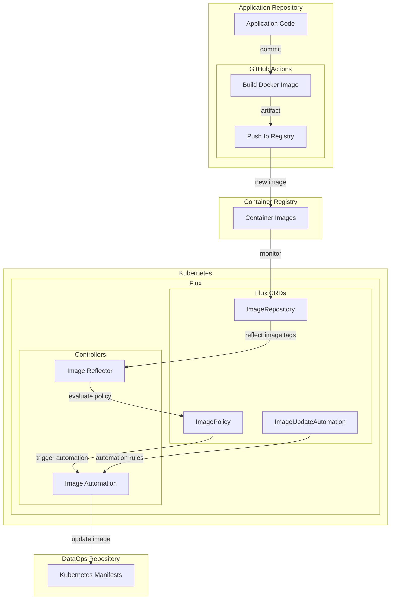

# Kubernetes Image Update Automation with Flux

## Problem
- Manual Container Image Updates: In traditional workflows, container images are manually updated in Kubernetes deployments, leading to delays and operational inefficiencies.

- Limited Access to Kubernetes: Project teams often do not have direct access to Kubernetes clusters for security and operational reasons, making it hard for them to independently manage container image updates.

## Solution
- Automatic Image Build and Push: Set up a GitHub Actions pipeline to automatically build a new Docker image every time there is a commit to the repository and push image to private container registry. This ensures that every change is automatically built into a container image, ready for deployment.

- Image Update Automation: Configured Flux to monitor container registries for new image versions. This allows the automated and seamless update of container images without manual intervention, allowing the teams to focus on their application logic instead of worrying about deployment infrastructure.

- Declarative Image Management: The container image versions are managed declaratively using GitOps, where Flux pulls image updates directly from Git, ensuring that Kubernetes resources are updated consistently.

- Container Registry Cleanup: This process leads to frequent image builds, it is important to manage the number of images in the registry with an automatic cleanup routine that delete outdated images, ensuring efficient container registry storage and cost control.

## Architecture

## Skills
- DevOps

- Platform Engineering

- GitOps

## Tools
- Docker

- Flux

- Github Actions

- Azure Container Registry

- Kubernetes
