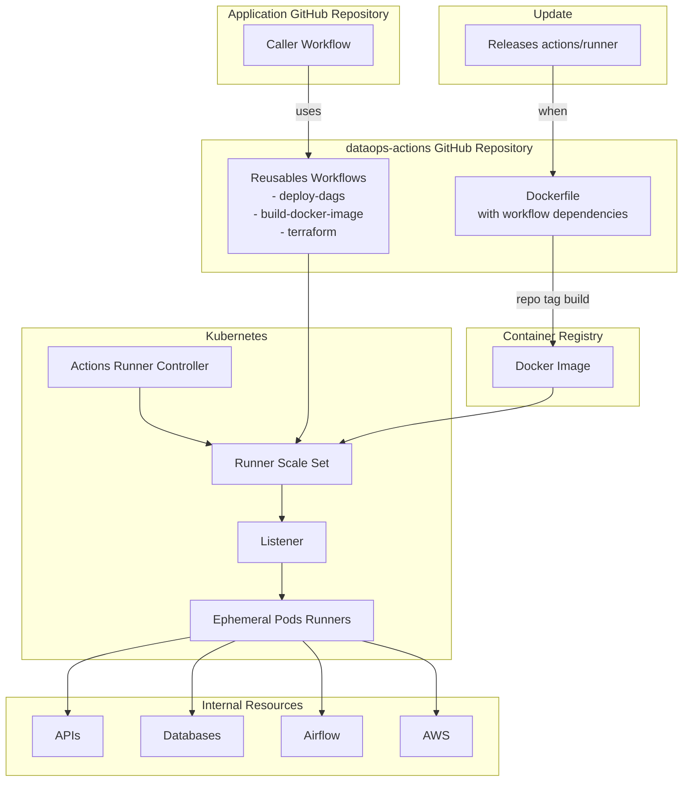

# Project

## Context
GitHub Actions workflows running on GitHub-hosted runners could not securely access internal services available only through private endpoints. This prevented CI/CD workflows that require private network access and introduced security/compliance concerns.

## Goals
- Run CI/CD workloads inside the private network.

- Allow secure access to internal/private endpoints.

- Improve compliance posture by keeping sensitive tasks inside controlled infrastructure.

- Scale runners based on demand.

- Reduce per-run setup time by using a prebuilt execution image.

## High-Level Architecture
- GitHub Actions workflows target self-hosted runners.

- Runners are deployed on Kubernetes in the private network.

- Actions Runner Controller (ARC) manages runner lifecycle.

- Runner Scale Sets provide autoscaling/high availability for runner capacity.

- Workflows run in a custom Docker image that includes required tools/dependencies.

## Architecture

## Key Components
- Actions Runner Controller (ARC)

- Runner Scale Set

- Kubernetes Cluster (private network)

- Custom Docker Image for workflow execution

- Private connectivity (private endpoints / internal DNS / internal routing)

## Security Considerations
- Network boundary: workflow traffic to internal services stays within the private network.

- Credential handling: prefer short-lived credentials and scoped permissions.

- Image provenance: ensure the custom runner image is built from trusted sources and scanned.

- Least privilege: runner service accounts and any cloud identities should be tightly scoped.

## Operational Notes
- Capacity is managed via Scale Sets to match workload demand.

- Custom image reduces time spent installing dependencies at runtime.
