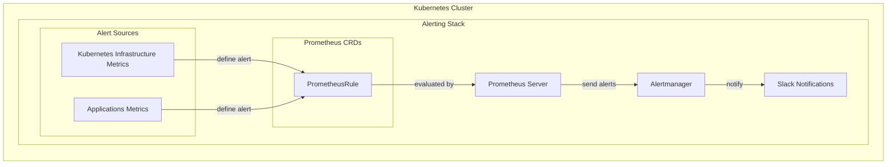

# Alerting Kubernetes Infrastructure and Critical Applications Issues with Alertmanager

## Problem
- Lack of Kubernetes Infrastructure Alerting: Without automated monitoring and alerting systems in place for Kubernetes infrastructure, issues such as node failures, pod crashes, or resource exhaustion could go undetected, leading to outages and service degradation.

- Lack of Critical Applications Alerting: Inadequate alerts for critical applications running within Kubernetes clusters meant that performance problems or failures could go unnoticed, causing significant disruptions to business operations.

- Inefficient Issue Response: Without predefined alerts and notifications, identifying and addressing issues within Kubernetes clusters and critical applications could be slow, resulting in longer downtime and increased operational overhead.

## Solution
- Alerting with Alertmanager: Configured Alertmanager to manage alerts for both Kubernetes infrastructure and critical applications. Customized alert thresholds and routing to ensure timely notifications and efficient responses to issues like pod failures, resource limits, and application downtimes.

- Declarative Alerting Rules: Implemented declarative alerting rules in Alertmanager for Kubernetes infrastructure and critical applications, following a GitOps approach to ensure version-controlled, consistent, and automated configuration management.

- Proactive Issue Detection: Alerts were tailored to notify teams of critical issues in real-time, minimizing the impact on service availability and performance.

## Architecture

## Skills
- DevOps

- Observability

- Site Reliability Engineering

## Tools
- Prometheus

- Alertmanager

- Kubernetes
